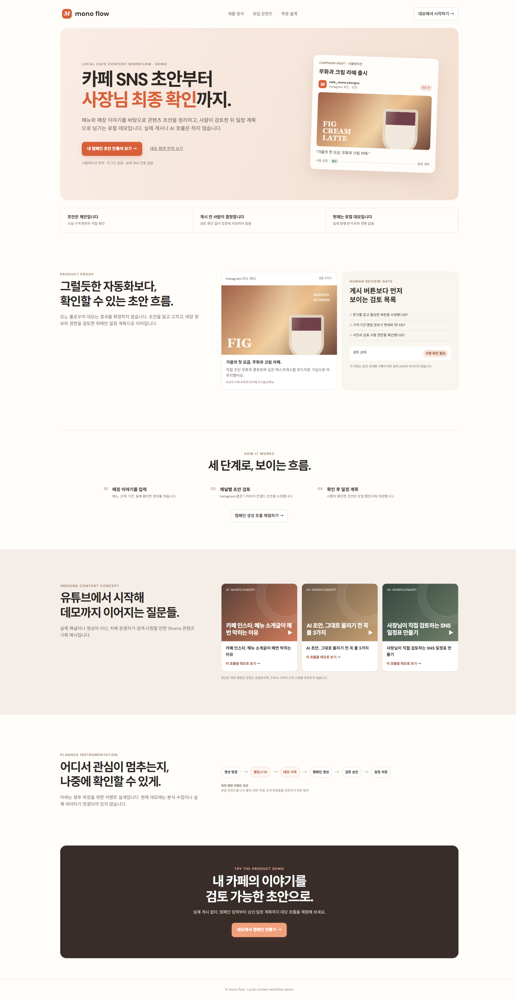
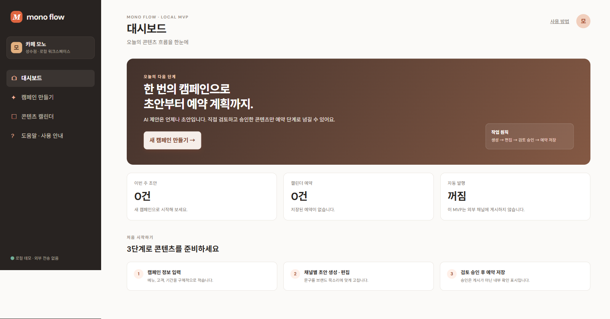
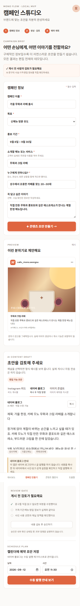

# Mono Flow

> **콘텐츠 발행을 서두르지 않도록 돕는, 사람 승인 중심의 로컬 SNS 운영 파일럿**

Mono Flow는 캠페인 정보를 정리하고 안전한 로컬 초안을 만든 뒤, 사람이 검토·승인한 콘텐츠만 발행 대기 상태로 넘기는 운영 도구입니다. 자동 게시보다 **사실 확인과 사람의 최종 판단**을 먼저 두는 흐름을 설계했습니다.



## 한눈에 보는 운영 흐름


이 흐름은 승인이 끝나기 전에는 일정 등록을 막고, 외부 발행 설정이 없는 경우 작업을 안전하게 보류합니다.

## 사용자가 얻는 것

| 단계 | 사용자 경험 | 안전 장치 |
| --- | --- | --- |
| 캠페인 | 제품, 고객, 이야기처럼 확인 가능한 사실을 입력 | 입력값·요청 크기·동일 출처를 검사 |
| 초안 | 로컬 개발 모드에서 검토용 콘텐츠를 생성 | 외부 AI 호출과 API 키 노출을 기본 범위에서 제외 |
| 승인 | 사람이 내용을 읽고 최종 판단 | 승인 전 일정 등록 차단 |
| 일정 | 승인된 초안만 발행 대기 상태로 정리 | 외부 발행 기능이 없는 기본 워커는 안전하게 보류 |

| 대시보드 | 모바일 흐름 |
| --- | --- |
|  |  |

## 핵심 기능

- 캠페인 생성과 지속 저장
- 로컬 계정 세션
- 안전한 로컬 초안 생성
- 사람 승인 후 일정 대기 등록
- 캠페인·승인 초안·일정 수를 보여 주는 간단한 분석 카운터

## 안전을 제품 흐름에 포함한 이유

콘텐츠 운영은 텍스트 생성만으로 끝나지 않습니다. 가격, 기간, 권리, 브랜드 표현처럼 확인이 필요한 사실은 사람이 검토해야 합니다. 그래서 Mono Flow는 다음 경계를 명시적으로 둡니다.

- 비밀번호는 Salted `scrypt` 해시만 저장하고, 세션은 `HttpOnly`/`SameSite=Strict` 쿠키로 처리합니다.
- API 키와 OAuth 토큰을 프런트엔드나 데이터 파일에 저장하지 않습니다.
- 캠페인 데이터는 소유자별로 제한하며, 변경 요청은 동일 출처·입력 검증·요청 크기·속도 제한을 거칩니다.
- `.local-data/`와 `.env`는 Git에서 제외됩니다.

## 기술 구성

- **Frontend:** React + Vite
- **Local API:** Node.js (`server.mjs`)
- **Storage:** 로컬 개발용 데이터 파일
- **Verification:** Node test runner 기반 API 스모크 테스트와 Vite 프로덕션 빌드

## 실행

```powershell
npm install

# 터미널 1
$env:DEV_LOCAL_AI='true'
npm run api

# 터미널 2
npm run dev
```

브라우저에서 Vite가 안내하는 주소(일반적으로 `http://127.0.0.1:5173`)를 엽니다.

## 검증

```powershell
npm run test:api
npm run build
```

## 현재 범위

이 프로젝트는 로컬 개발 파일럿이며 프로덕션 배포본이 아닙니다. 외부 AI 호출, 실제 SNS OAuth, 자동 게시, 실계정 데이터 수집은 구현하거나 설정하지 않았습니다. 향후 외부 연동을 추가할 때도 승인 흐름, 자격 증명 관리, 감사 가능성, 실패 시 보류 동작을 함께 검증해야 합니다.

세부 실행/복구: [SERVICE_RUNBOOK.md](SERVICE_RUNBOOK.md) · 데이터: [DB_SCHEMA.md](DB_SCHEMA.md) · 보안과 출시 전 요건: [SECURITY.md](SECURITY.md) · 사용 흐름: [USER_MANUAL.md](USER_MANUAL.md)

---

**Design note:** 이 문서는 사용자 가치, 운영 흐름, 실제 화면, 안전 경계, 구현 범위를 구분해 보여 줍니다. 현재 구현과 향후 연동을 혼동하지 않도록 범위를 명시했습니다.
